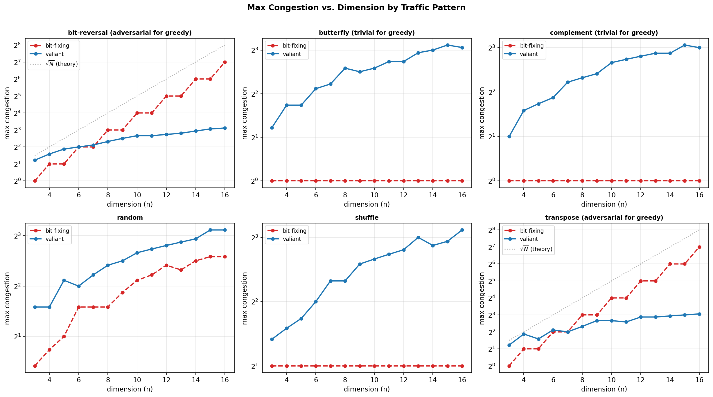
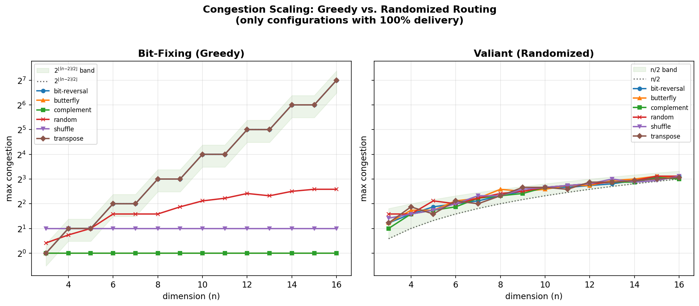
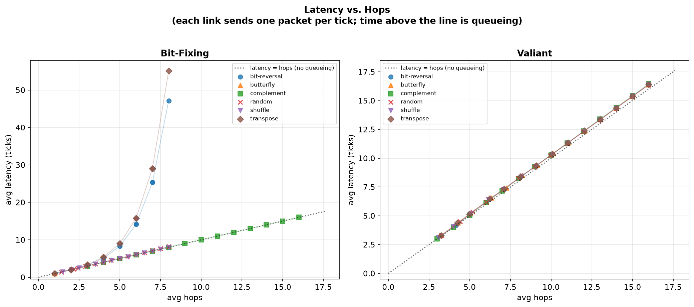
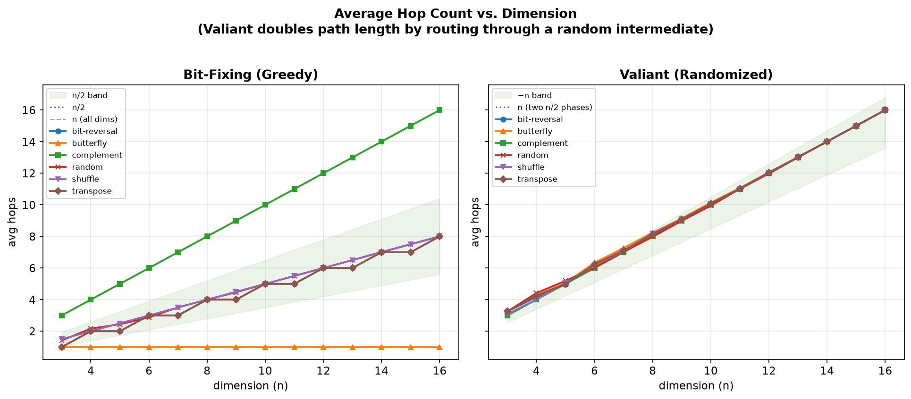

# Hypercube

A distributed hypercube routing simulator written in Rust. Simulates packet routing on n-dimensional hypercube networks and measures congestion, latency, and hop counts against theoretical bounds.

Each node runs as an independent async task (via Tokio), communicating through per-dimension channels with tick-synchronized barriers. The topology is implicit -- neighbors are computed via bit arithmetic, so no adjacency lists are stored.

## Why hypercubes?

An n-dimensional hypercube connects 2^n nodes where each node's neighbors differ by exactly one bit. This structure has been foundational in parallel computing theory since the 1980s:

- **Valiant and Brebner (1981)** proved that randomized two-phase routing achieves O(n) congestion on any permutation, vs. the Theta(sqrt(N)) worst-case of deterministic greedy routing.
- **The Connection Machine CM-2** (1987) was a physical 16-dimensional hypercube with 65,536 processors.
- Modern data center topologies (HyperX, fat-trees, dragonfly) trace their lineage to hypercube routing theory.

This simulator lets you run those classical experiments directly and verify the theoretical results.

## Quick start

```bash
# Single run: 10-cube, Valiant routing, bit-reversal traffic
cargo run --release -- --dim 10 --strategy valiant --traffic bit-reversal --max-ticks 80

# Sweep across dimensions and strategies, output to CSV
cargo run --release -- --sweep --dim-range 3:14 --strategy both --traffic bit-reversal -o results.csv

# Full parameter sweep: all traffic patterns, varying channel capacity
cargo run --release -- --sweep --dim-range 4:12 --strategy both \
    --traffic-range all --capacity-range "64:256:64" -o sweep.csv

# Generate charts from sweep data
python3 -m venv .venv && .venv/bin/pip install matplotlib pandas
.venv/bin/python scripts/plot.py sweep.csv
```

## Routing strategies

| Strategy | Flag | Description | Worst-case congestion |
|----------|------|-------------|----------------------|
| **Bit-fixing** | `--strategy bitfix` | Greedy: fix differing bits MSB-first | Theta(sqrt(N)) |
| **Valiant** | `--strategy valiant` | Two-phase: route to random intermediate, then to destination | O(n) w.h.p. |
| **Fault-tolerant** | `--strategy fault-tolerant` | Misroutes around faulty nodes/links | Depends on fault count |
| **Both** | `--strategy both` | Runs bit-fixing and Valiant (for sweep comparisons) | -- |

## Traffic patterns

| Pattern | Flag | Description |
|---------|------|-------------|
| **Bit-reversal** | `--traffic bit-reversal` | Node x sends to reverse(x). Classic adversarial pattern. |
| **Complement** | `--traffic complement` | Node x sends to NOT(x). Every packet traverses all n dimensions. |
| **Transpose** | `--traffic transpose` | Swaps upper and lower address halves. |
| **Butterfly** | `--traffic butterfly` | Swaps bit 0 and bit n-1. Models FFT cross-wiring. |
| **Shuffle** | `--traffic shuffle` | Circular left-shift of address bits. Models shuffle-exchange networks. |
| **Random** | `--traffic random` | Uniform random permutation (Fisher-Yates). |
| **Identity** | `--traffic identity` | Each node sends to itself. Zero-hop baseline. |

## CLI reference

### Single run

```
cargo run --release -- [OPTIONS]
```

| Option | Default | Description |
|--------|---------|-------------|
| `--dim` | 6 | Hypercube dimension (nodes = 2^dim) |
| `--strategy` | valiant | Routing strategy |
| `--traffic` | bit-reversal | Traffic pattern |
| `--max-ticks` | 100 | Simulation duration in ticks |
| `--seed` | 42 | RNG seed |
| `--channel-capacity` | 256 | Buffer size per inter-node link |
| `--faults` | 0 | Number of random node faults to inject |
| `-o, --output` | stdout | CSV output file path |

### Sweep mode

```
cargo run --release -- --sweep [OPTIONS]
```

| Option | Default | Description |
|--------|---------|-------------|
| `--dim-range` | 3:12 | Dimension range (lo:hi inclusive) |
| `--strategy` | valiant | Strategy (use `both` to compare) |
| `--traffic-range` | (uses --traffic) | `"all"` or comma-separated list |
| `--capacity-range` | (uses --channel-capacity) | `start:end:step` format |
| `--runs` | 1 | Runs per configuration (vary seed) |

## CSV output

Each row is one simulation run:

```
dimension,nodes,strategy,traffic,total_packets,delivered,max_congestion,avg_congestion,max_latency,avg_latency,max_hops,avg_hops,per_dim_load,per_dim_max_queue
8,256,valiant,bit-reversal,256,256,4,1.02,9,4.50,14,8.13,266;282;268;256;252;254;254;250,0;0;0;0;0;0;0;0
```

The `per_dim_load` and `per_dim_max_queue` columns are semicolon-delimited, one value per dimension. This lets you analyze congestion distribution across dimensions.

## Architecture

```
src/
  lib.rs                    Library root
  main.rs                   CLI binary
  cli.rs                    Argument parsing (clap)
  engine/
    mod.rs                  Simulation orchestration
    builder.rs              Channel and node assembly
  node/
    mod.rs                  Async node event loop
  packet.rs                 Packet structure and routing phases
  routing/
    mod.rs                  RoutingStrategy trait
    bitfix.rs               Bit-fixing (greedy) routing
    valiant.rs              Valiant's two-phase routing
    fault_tolerant.rs       Fault-tolerant routing with misrouting
  topology/
    mod.rs                  Hypercube structure and neighbor queries
    address.rs              NodeId and bitwise operations
    faults.rs               Node and link fault tracking
  traffic/
    mod.rs                  TrafficPattern trait
    permutations.rs         Deterministic permutation patterns
    random.rs               Random permutation (Fisher-Yates)
    hotspot.rs              Hot-spot traffic pattern
  stats/
    mod.rs                  Statistics module
    metrics.rs              NodeStats and SimulationStats
    export.rs               CSV output
```

**Key design decisions:**
- **Implicit topology**: No adjacency lists. Neighbors are computed via `node_id XOR (1 << dim)`. This uses O(1) space per node.
- **Tick-synchronous**: All nodes advance together via a shared barrier. This matches the BSP (Bulk Synchronous Parallel) model used in the theoretical analysis.
- **Per-node async tasks**: Each node is a `tokio::spawn` task with its own channel endpoints. This models the distributed nature of the system but limits scalability beyond ~16 dimensions.

## Performance

Measured on a single machine (release build):

| Dimension | Nodes | Approx. runtime |
|-----------|-------|-----------------|
| 8 | 256 | instant |
| 12 | 4,096 | < 1s |
| 14 | 16,384 | ~1s |
| 16 | 65,536 | ~17s |

## Results

Generated from a full sweep across dimensions 3--16 (8 to 65,536 nodes), 6 traffic patterns, both routing strategies, 3 runs per configuration (504 simulations):

```bash
cargo run --release -- --sweep --dim-range 3:16 --strategy both \
    --traffic-range "bit-reversal,complement,transpose,butterfly,shuffle,random" \
    --runs 3 -o full_study.csv
.venv/bin/python scripts/plot.py full_study.csv
```

### Congestion scaling by traffic pattern



Three distinct regimes emerge. **Adversarial patterns** (bit-reversal, transpose): bit-fixing congestion tracks the theoretical sqrt(N) bound while Valiant stays at O(n) -- the crossover is visible around dim 5--7. **Easy patterns** (butterfly, complement): bit-fixing achieves congestion 1 due to perfect routing symmetry, while Valiant *increases* congestion by adding unnecessary random intermediates. **Middle ground** (random, shuffle): bit-fixing stays low, Valiant's overhead is the dominant cost. This is the classic tradeoff -- Valiant fixes worst-case but hurts best-case.

### Strategy comparison



Left panel (greedy): congestion spans 7 orders of magnitude depending on traffic -- bit-reversal/transpose explode to 128 at dim=16, while complement/butterfly sit at 1. Right panel (Valiant): all patterns collapse into a tight O(n) band. This is Valiant's guarantee -- congestion is traffic-oblivious, at the cost of never being optimal on easy patterns.

### Latency vs. hops



In the tick-synchronous model, all nodes forward simultaneously, so packets traverse ~2 hops per tick via pipelining. Latency scales linearly with hop count across all patterns. Bit-fixing shows clear separation: complement (16 hops at dim=16) has the highest latency while butterfly (avg 1 hop, max 2) has the lowest. Valiant collapses all patterns into a tight band since the random intermediate dominates path length regardless of traffic.

### Hop distribution



Left panel (greedy): hop count is traffic-dependent. Complement always traverses all n dimensions (max distance). Butterfly averages 1 hop (swaps only bits 0 and n-1, but packets needing both flips take 2 hops). Bit-reversal, transpose, shuffle, and random cluster around n/2 -- the expected Hamming distance for "average" permutations. Right panel (Valiant): the random intermediate roughly doubles path length, pushing all patterns toward n hops. The n/2 reference line shows the expected hops for a single random-to-random leg.

## Theory notes

Some observations from the data that connect back to the classical results.

### Why sqrt(N) congestion?

Consider bit-reversal on a 16-cube. Node `0000000011111111` sends to `1111111100000000`. Under MSB-first bit-fixing, the packet first flips bit 15, then bit 14, ..., then bit 0. The key insight is that **all packets whose source and destination differ on bit k must cross the same set of dimension-k edges** in the same direction. For bit-reversal, bit k is flipped whenever source bit k differs from source bit (n-1-k). At the "middle" dimensions (around k = n/2), many packets funnel through the same edge -- this is the bottleneck that creates the Theta(sqrt(N)) bound.

Our data shows max_congestion exactly tracks 2^(floor((d-2)/2)) for dimensions 3--16. For even n this equals sqrt(N)/2; for odd n it's sqrt(N)/(2*sqrt(2)). The exact progression is: 1, 2, 2, 4, 4, 8, 8, 16, 16, 32, 32, 64, 64, 128 for dims 3--16.

### Why complement has congestion 1

The complement permutation (node x sends to NOT(x)) flips every bit. Under MSB-first bit-fixing, every packet traverses all n dimensions. The total per-dimension load is N (every packet crosses every dimension). Each dimension has N directed edges (one per node), so the average per-edge load is N/N = 1. In fact the maximum is also 1: complement is a perfect matching on every dimension cut, so no directed edge carries more than one packet. This gives max_congestion = 1 regardless of dimension.

### The Valiant tradeoff in numbers

Valiant's two-phase routing sends each packet to a uniformly random intermediate node before routing to the true destination. This guarantees O(n) congestion on *any* permutation -- our data confirms max_congestion of 8--9 at dim=16 across all six traffic patterns.

The cost is path length. Bit-fixing on bit-reversal averages floor(n/2) hops; Valiant averages ~n (the expected Hamming distance of two random nodes is n/2 per phase, times two phases). For "easy" patterns like butterfly (avg 1 hop with bit-fixing), Valiant inflates to ~n hops -- a ~16x penalty at dim=16 for no congestion benefit.

The crossover where Valiant becomes worthwhile is visible in the congestion scaling charts around dim 6--8 for adversarial patterns. At dim=6 for bit-reversal, bit-fixing congestion is 4, while Valiant varies across runs (3--5 in our data) -- so Valiant sometimes wins but not consistently. By dim=8, Valiant reliably beats bit-fixing (congestion 4--6 vs. 8 for bit-reversal). Below dim=8, bit-fixing's congestion is still small enough to compete with Valiant's randomized overhead.

### Odd-dimension fixed points

For odd n, the bit-reversal permutation has a fixed point at the middle bit (bit floor(n/2)): reversing the bit positions maps the middle bit to itself. This means no packet ever needs to flip that dimension, so its per-dimension load is exactly 0. You can see this in the per_dim_load column -- odd dimensions have one zero entry. This is also why avg_hops = floor(n/2) rather than n/2 for bit-reversal.

### Shuffle is surprisingly well-behaved

The perfect shuffle (circular left-shift of the address) averages n/2 hops per packet, so individual packets don't touch all dimensions. But our data shows max_congestion = 2 for bit-fixing across all dimensions 3--16. The reason: shuffle distributes load with remarkable uniformity. The per-dimension load is exactly N/2 for every dimension -- every dimension carries exactly the same total traffic. With N/2 packets spread across N/2 directed edges per dimension, the average per-edge load is 1, and the maximum is 2. Unlike bit-reversal, the rotation structure avoids funneling packets through a bottleneck at the middle dimensions.

## Related work

- [BookSim](https://github.com/booksim/booksim2) -- Stanford's interconnection network simulator. The standard tool in computer architecture research. Supports many topologies and routing algorithms.
- Valiant, L. G. (1982). "A scheme for fast parallel communication." *SIAM Journal on Computing*.
- Leighton, F. T. (1992). *Introduction to Parallel Algorithms and Architectures*. Morgan Kaufmann. Chapters 3-4 cover hypercube routing theory.

## Future: Multi-core interconnect for rvsim

This project is designed to eventually serve as the **network-on-chip (NoC) layer** for [rvsim](https://github.com/willmccallion/rvsim), a cycle-accurate RISC-V system simulator. The goal is to connect multiple rvsim cores through a hypercube interconnect, creating a full many-core simulator with realistic network contention modeling.

The integration path:

1. **Multi-core rvsim** — instantiate N cores with private L1 caches sharing a coherence domain
2. **Cache coherence protocol** — MESI/MOESI directory-based coherence, where invalidations, fetches, and writebacks become network messages
3. **Hypercube as the NoC transport** — coherence messages are packets routed through the hypercube. Miss latency depends on network congestion, hop count, and routing strategy — all things this simulator already measures
4. **Unified design-space exploration** — sweep over core count, cache sizes, network dimension, and routing strategy simultaneously to study the interplay between microarchitecture and interconnect

This mirrors the architecture of gem5's Ruby (coherence) + Garnet (network) subsystems, but built from scratch in Rust with both the CPU and network models under the same roof.

## License

MIT OR Apache-2.0
